## Еловиков Виктор ЛА3 Лабораторная №4
# Задание 1. List (вариант 3)
### Текст задачи
Даны упорядоченные списки L1 и L2. Вставить элементы списка L2 в список L1, не нарушая его упорядоченности.

Алгоритм решения
Создан обобщённый класс L1<T> с полем List<T> args и методом InsertInOrder(T item), который вставляет элемент в нужную позицию, сохраняя упорядоченность. Аналогичный класс L2<T> используется для второго списка. В методе Task1 программы запрашивается тип элементов (числа или текст), затем вводятся элементы L1 и L2. После этого все элементы L2 по одному вставляются в L1 с помощью InsertInOrder. Выводятся исходные списки и результат.

Тестирование
````
Входные данные:
Тип элементов L1: 1
Элементы L1: 1 3 5
Тип элементов L2: 1
Элементы L2: 2 4 6
````
````
Выходные данные:
L1: 1 3 5
L2: 2 4 6
Результат: 1 2 3 4 5 6
````

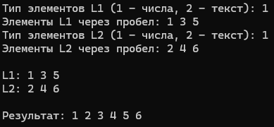

# Задание 2. LinkedList (вариант 3)
Текст задачи
Подсчитать количество элементов списка L, у которых равные «соседи».
Алгоритм решения
В классе L1<T> добавлен метод CountEqualNeighbors(), который проходит по списку и для каждого элемента (кроме первого и последнего) сравнивает его левого и правого соседа. Если они равны, счётчик увеличивается. В методе Task2 программы создаётся список (числовой или строковый), элементы вставляются с сохранением порядка, затем вызывается CountEqualNeighbors() и выводится результат.

Тестирование
````
Входные данные:
Тип элементов: 1
Элементы: 1 2 2 2 3
````

````
Выходные данные:
Список: 1 2 2 2 3
Элементов с равными соседями: 1
````

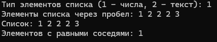

# Задание 3. HashSet (вариант 3)
Текст задачи
Задан некоторый набор блюд в кафе. Определить для каждого из блюд, какие из них заказывали все посетители, какие — некоторые из посетителей, и какие не заказывал никто.
Алгоритм решения
Создан класс Cafe, содержащий меню (List<string>) и список заказов посетителей (List<HashSet<string>>). Реализованы методы:
DishesOrderedByAll() – блюда, которые есть в каждом заказе;
DishesOrderedBySome() – блюда, которые заказал хотя бы один, но не все;
DishesOrderedByNobody() – блюда, отсутствующие во всех заказах.
В методе Task3 программы вводится меню (через запятую), количество посетителей и заказы каждого (через запятую). Затем выводятся три списка.

Тестирование
````
Входные данные:
Меню: суп, салат, чай, кофе
Посетителей: 2
Заказ 1: суп, чай
Заказ 2: суп, салат, чай
````
````
Выходные данные:
Заказывали ВСЕ: суп, чай
Заказывали НЕКОТОРЫЕ: салат
Не заказывал НИКТО: кофе
````

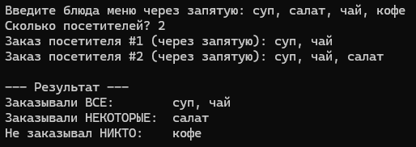

# Задание 4. HashSet (вариант 3)
Текст задачи
Файл содержит текст на русском языке. Напечатать в алфавитном порядке все согласные буквы, которые входят ровно в одно слово.
Алгоритм решения
Создан класс TextAnalyzer с методом ConsonantsInExactlyOneWord(). Текст разбивается на слова с помощью разделителей, приводится к нижнему регистру. Для каждой согласной буквы (из предопределённого множества) подсчитывается, в скольких словах она встречается (учитывается уникальность внутри слова). Затем отбираются буквы, встретившиеся ровно в одном слове, сортируются по алфавиту. В методе Task4 программы запрашивается путь к файлу, читается текст и выводится результат.

Тестирование
````
Файл task4.txt:
мама мыла раму
Согласные: м, л, р. Буква «м» встречается в словах «мама» и «мыла» (2 слова), «л» – в «мыла» (1 слово), «р» – в «раму» (1 слово). Результат: л, р.
````
````
Выходные данные:
Согласные, входящие ровно в одно слово: л, р
````

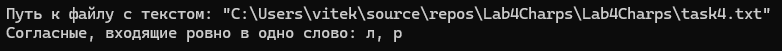

# Задание 5. Dictionary/SortedList (вариант 3)
Текст задачи
На вход программы подаются сведения о результатах соревнований по школьному многоборью. Многоборье состоит из соревнований по четырем видам спорта, участие в каждом из которых оценивается баллами от 0 до 10. Победители определяются по наибольшей сумме набранных баллов. Известно, что общее количество участников не превосходит 100. В первой строке вводится количество учеников N. Далее следуют N строк формата: <Фамилия> <Имя> <баллы>, где <баллы> – четыре целых числа. Напишите программу, которая будет выводить на экран фамилии и имена трёх лучших участников многоборья. Если среди остальных участников есть ученики, набравшие то же количество баллов, что и один из трёх лучших, то их фамилии и имена также следует вывести.

Алгоритм решения
Создан класс Multathlon, который загружает данные из файла в Dictionary<string, int> (ключ – «Фамилия Имя», значение – сумма баллов). Метод GetTopWithTies(3) сортирует участников по убыванию суммы, определяет пороговый балл для третьего места и возвращает всех, чья сумма не меньше порога. В методе Task5 программы запрашивается путь к файлу; если файла нет, предлагается создать его с помощью CreateMultathlonFile. Затем выводятся лучшие участники.

Тестирование
````
Файл task5.txt:
5
Иванова Мария 5 8 6 3
Петров Сергей 9 9 5 7
Сидорова Ольга 10 10 8 9
Козлов Иван 7 7 7 7
Смирнова Анна 8 8 8 8
Суммы: Иванова – 22, Петров – 30, Сидорова – 37, Козлов – 28, Смирнова – 32.
Топ-3: Сидорова (37), Смирнова (32), Петров (30).
````
````
Выходные данные:
Сидорова Ольга: 37
Смирнова Анна: 32
Петров Сергей: 30
````

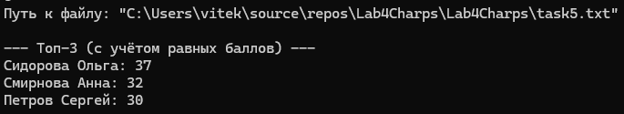

# Задание 6. Перегрузка операций (вариант 3)
Текст задачи
Реализовать класс Point с полями double x, double y (координаты точки). Метод: вычислить расстояние от одной точки до другой. Результат должен быть типа double. Перегрузить метод ToString() для вывода полей. Протестировать все методы, включая конструкторы.

Алгоритм решения
Создан класс Point (проект Lab6_7) с полями x, y, свойствами X, Y (с проверкой на конечность чисел), конструкторами по умолчанию, с параметрами и копирования. Реализован метод DistanceTo(Point other), вычисляющий евклидово расстояние. Переопределён ToString() для вывода в формате (x; y). В методе Main программы реализованы тесты: создание точек разными конструкторами, проверка защиты от NaN/Infinity, вычисление расстояния между двумя точками.

Тестирование
````
--- Конструкторы ---
По умолчанию:        (0; 0)
С параметрами (3,4): (3; 4)
Копия p2:            (3; 4)
p2 == p3 ? True

Проверка защиты от NaN/Infinity:
  поймано: Координата X должна быть конечным числом.
  поймано: Координата Y должна быть конечным числом.
````
````
--- Расстояние DistanceTo ---
Введите точку A:
  A.X = 0
  A.Y = 0
Введите точку B:
  B.X = 3
  B.Y = 4
Расстояние (0; 0) -> (3; 4) = 5,0000
````

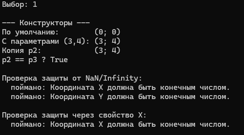

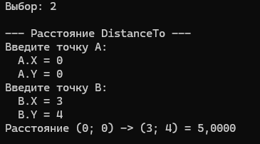

# Задание 7. Перегрузка операций (вариант 3)
Текст задачи
Добавить к классу Point перегруженные операции:
унарные: ++ (увеличить координату x на 1), -- (уменьшить координату x на 1);
приведения типа: int (явная) – целая часть координаты x; double (неявная) – координата y;
бинарные: + Point p – вычисляется расстояние до точки p (результат вещественный); + с целым числом (лево- и правосторонняя операции) – увеличивается координата x, результат типа Point.
Протестировать все операции.

Алгоритм решения
В класс Point добавлены:
operator ++ и operator -- (изменяют x на ±1 и возвращают точку);
explicit operator int(Point p) – возвращает (int)p.x;
implicit operator double(Point p) – возвращает p.y;
operator +(Point a, Point b) – возвращает расстояние между точками;
operator +(Point p, int n) и operator +(int n, Point p) – возвращают новую точку с увеличенной координатой x.
Также перегружены == и != для корректного сравнения. В методе Main добавлены тесты для каждой операции.

Тестирование
````
--- Унарные ++ и -- ---
Введите точку p:
  p.X = 1
  p.Y = 2
Исходная: (1; 2)
++p : результат = (2; 2), p = (2; 2)
--p : результат = (1; 2), p = (1; 2)
````
````
--- Приведение типов ---
Введите точку p:
  p.X = 3.7
  p.Y = 4.2
(int)p = 3   (целая часть X)
double d = p;  d = 4.2   (значение Y)
p + 0.5 = 4.7   (сработало неявное приведение Y)
````
````
--- Оператор + с целым числом ---
Введите точку p:
  p.X = 1
  p.Y = 2
  n = 5
p + n = (6; 2)   (p не изменён: (1; 2))
n + p = (6; 2)   (p не изменён: (1; 2))
````
````
--- Равенство точек ---
Введите точку A: (1; 2)
Введите точку B: (1; 2)
a == b ? True
a != b ? False
a.Equals(b) ? True
a == null ? False
null == null ? True
````

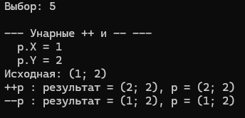

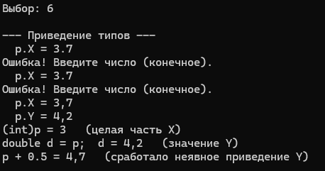

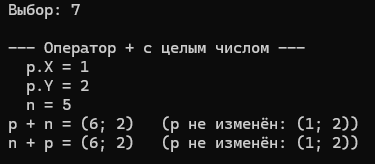

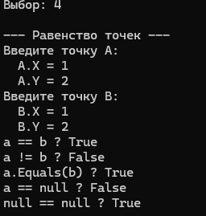
